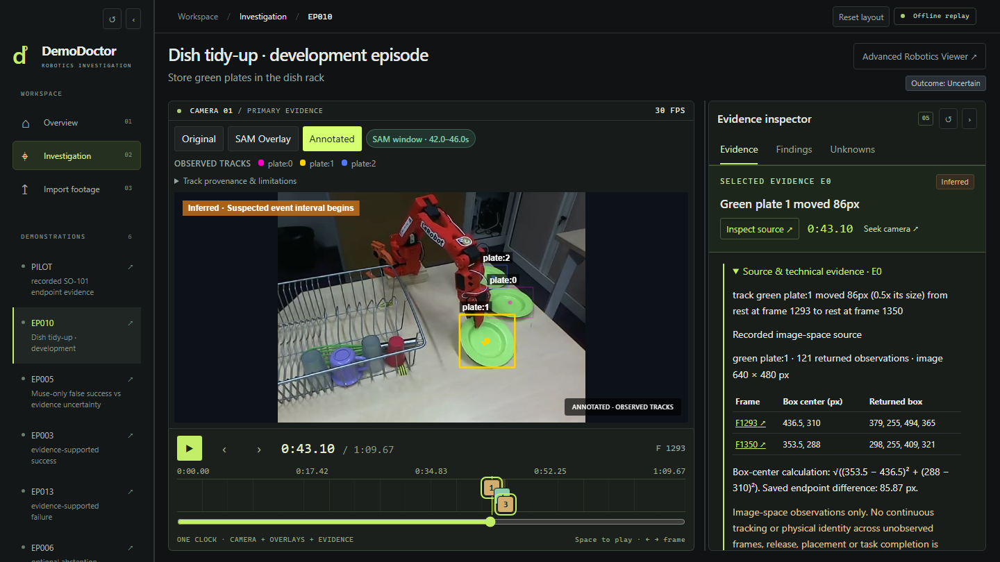
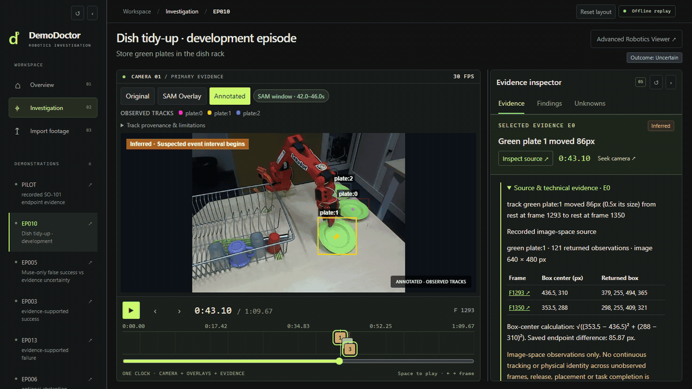
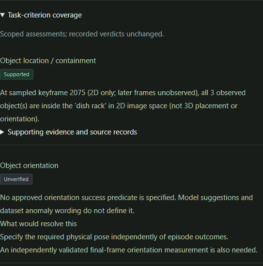
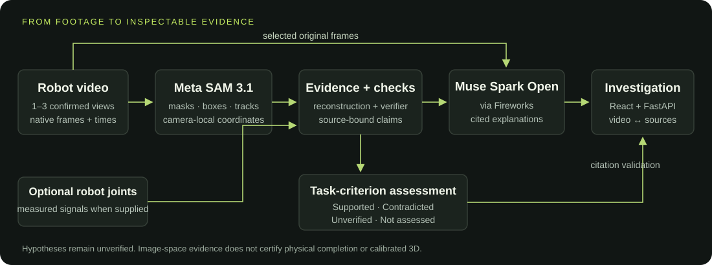
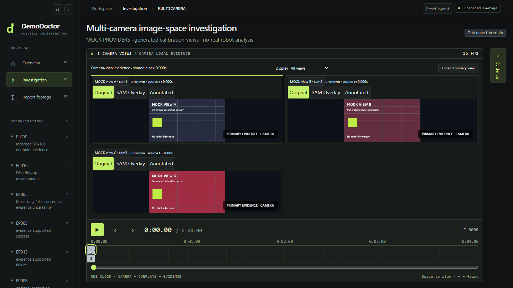

<div align="center">

# DemoDoctor

### See what the robot did. Understand what went wrong.

Investigate robot demonstrations with synchronized video, SAM observations,<br/>source-backed checks and cited Muse explanations. Keep missing evidence visible.

<p>
  <a href="#how-it-works"></a>
  <a href="#how-it-works"></a>
  
  <a href="LICENSE"></a>
</p>

**[▶ Watch the three-minute demo](https://youtu.be/MLNE2nCu_6I)**

[Quick start](#quick-start) · [Features](#features) · [Architecture](#how-it-works) · [Limitations](#results-and-limitations)

</div>

## 75-Second Research Walkthrough

[](https://github.com/user-attachments/assets/a71181fa-8b83-4ede-8447-849f3c58f9e3)

**[▶ Watch the 75-second research walkthrough](https://github.com/user-attachments/assets/a71181fa-8b83-4ede-8447-849f3c58f9e3)** · [GitHub player and media credits](https://github.com/est4ever/DemoDoctor/issues/3)

This 75-second walkthrough demonstrates DemoDoctor's evidence-grounded investigation workflow on real SO-101 robot manipulation footage, including source-linked visual observations, timestamped evidence, and explicit uncertainty handling. The demonstrated visual analysis is AI-assisted; autonomous physical grasp and task-completion verification remain under development.

*Silent, captioned source-frame explainer—not autonomous gripper recognition. Nine original frames support a narrow 2D visible-region measurement; grasp, attachment, release and task completion remain unverified. This uses the SO-101 development recording, not the fresh Episode 2 experiment.*

Footage adapted from [ankithreddy/so101_pickplace_uno](https://huggingface.co/datasets/ankithreddy/so101_pickplace_uno), publisher-declared Apache-2.0; source card credits LeRobot. [License and notices](docs/submission/THIRD_PARTY.md) · [Transformations, provenance and video hash](https://github.com/est4ever/DemoDoctor/issues/3). The [main three-minute hackathon demo](https://youtu.be/MLNE2nCu_6I) remains the primary submission video.



*Actual application capture from the bundled EP010 replay. Annotations and calculations are recorded evidence; an inferred event is not proof of physical release or placement.*

## The problem

**Optional assisted final-placement assessment:** [portable setup and original-source download](docs/integration/PORTABLE_PLACEMENT_SETUP.md). Provision the two publisher originals once (63.25 MB), then compute and reopen source-linked findings offline. No API keys or private developer cache are required; the bundled re-encode is not substituted for measurement sources.

A robot video shows motion. It rarely tells you whether a grasp held, a placement finished, or an occlusion hid the decisive moment. A plausible explanation can still be wrong.

DemoDoctor brings the footage and its evidence into one workstation, so an investigator can inspect **what was observed, what was inferred, and what is still unknown**.

## Observe. Verify. Explain.

| Observe | Verify | Explain |
|---|---|---|
| SAM 3.1 supplies camera-local masks, boxes and tracks. Paired robot recordings can supply measured joint signals. | Deterministic checks assess supported claims and explicit task criteria within their evidence scope. | Muse Spark Open produces cited explanations and possible mechanisms. Hypotheses remain **Unverified**. |

## Features

### Follow the evidence back to the footage

Select evidence, seek its recorded timestamp, step frames and inspect the underlying source. Untimed evidence opens its provenance without inventing a timestamp. The video and timeline stay visible while the inspector scrolls independently.



*An 11-second screen capture of the cached investigation. The timestamp jumps are deliberate seeks; no new inference or continuous robot trajectory is implied.*

### See what would resolve uncertainty

Task-criterion coverage uses **Supported · Contradicted · Unverified · Not assessed**. Each unresolved criterion explains what observation or measurement is missing. Saved diagnostic hypotheses, original frame context and technical citations remain inspectable.

<p align="center"></p>

*EP003 supports a sampled 2D containment finding. Physical orientation and full task completion remain unverified.*

Other workstation tools include resizable side panels, camera-specific overlays, saved-investigation history with offline reopening, and an optional lazy-loaded Rerun viewer for EP010.

## How it works



**Meta SAM 3.1** supplies visual observations. **Muse Spark Open**, accessed through Fireworks, reasons over camera-labelled evidence and selected original frames. Independent checks and citation validation constrain what reaches the investigation.

Model prose does not become a physical measurement. Task assessment is separate from the saved outcome; the original PILOT Muse citations remain bound to their original package, not the later offline reconstruction.

[Architecture details](docs/submission/ARCHITECTURE.md) · [Criterion semantics](docs/integration/CRITERIA_INTEGRATED.md) · [Source provenance](docs/integration/DIAGNOSTIC_CONTEXT.md)

## Results and limitations

| Demonstrated | What that establishes |
|---|---|
| **Six bundled replays** | Recorded investigations open without credentials or new provider calls. |
| **One completed unfamiliar-video run** | The owner initiated genuine SAM/Muse analysis through React on a private single-view DROID recording. It completed with an **Uncertain** outcome; its private media and job are not distributed. |
| **1/2/3-camera workflows** | Upload, crop/alignment confirmation, independent evidence and synchronized playback were **mock-tested**. Genuine multi-camera provider execution is not claimed. |

The recorded SO-101 PILOT contains two independently checked image-space claims: box centers approximately **609 pixels apart**, with a **105-frame observation gap**. Destination segmentation returned **no usable tray mask**. These observations do not prove continuous travel, release or placement; its outcome stays **Uncertain**.

Physical grasp/release, orientation, mechanical closure and full task completion often remain unverified. There is no calibrated 3D reconstruction or verified cross-camera identity, and **no validated generalized failure-detection accuracy**. Abstention is not successful failure identification. EP005's saved flat-orientation suggestion remains an Unverified hypothesis, not a detected fact.

[Recorded results and scientific limits](docs/submission/RESULTS.md) · [Diagnostic coverage audit](DIAGNOSTIC_COVERAGE_AUDIT.md)

## Quick start

**No API keys, `.env`, dataset download or paid inference is needed for the six replays.** Install dependencies once; replay then runs locally. Tested on Windows PowerShell 5.1, Python 3.12 and Node 24.19; use Python 3.12 and Node 22.12+.

```powershell
git clone https://github.com/est4ever/DemoDoctor.git
cd DemoDoctor
python -m venv .venv
.\.venv\Scripts\python.exe -m pip install -r requirements-lock.txt
Push-Location web
npm ci
Pop-Location
.\scripts\start-demodoctor.ps1
```

The launcher opens the browser after FastAPI (`127.0.0.1:8765`) and React (`127.0.0.1:5173`) are ready. It defaults to offline replay and Dry Run uploads, reuses verified services and returns control to PowerShell.

For your first visit, open **EP005 → Findings** to inspect an Unverified orientation hypothesis, then **EP010 → Evidence → Inspect source** to examine a measured gripper sample. Use Play/Pause, Previous/Next frame and the numbered timeline markers; untimed evidence opens its source without moving the video. On a narrow window, expand the navigation or Evidence drawer; Escape closes it. Arrow keys resize the desktop dividers.

**Saved analysis replay** makes no new provider calls. **Dry Run** prepares footage and generates no physical findings. **Real Analysis · saved outputs** describes local SAM/Muse execution records, not independently verified actions. **Experimental / unconfirmed** results must not be treated as genuine provider validation. Two-/three-camera integration remains experimental and mock-tested. [Short user guide, mode labels and release checklist](docs/submission/LOCAL_PROTOTYPE.md).

| Open | Inspect |
|---|---|
| **EP010** | Measured gripper opening, SAM tracks and qualified release inference |
| **PILOT** | Real recorded SAM/Muse evidence, observation gap and missing destination mask |
| **EP005** | Unverified orientation hypothesis; uncertain outcome |
| **EP003** | Supported sampled 2D containment; physical completion unverified |
| **EP013** | Recorded end-state-supported failure |
| **EP006** | Abstention from insufficient geometry |

```powershell
.\scripts\status-demodoctor.ps1
.\scripts\stop-demodoctor.ps1
```

Run start/status/stop from the repository root. Stop closes only servers managed by that checkout's launcher; it keeps saved jobs. It leaves unrelated or manually started processes alone. If a port is occupied, read the status message and close only the service you own; the launcher will not kill it for you.

If PowerShell blocks an unsigned script, inspect the trusted checkout, then use `powershell.exe -NoProfile -ExecutionPolicy Bypass -File .\scripts\start-demodoctor.ps1` (similarly for status/stop). This is a process-only exception, not a global policy change; no administrator permission is required.

**Localhost prototype:** the local API is unauthenticated. Keep it on `127.0.0.1`; do not port-forward it, tunnel it publicly or treat it as a production Internet service.

Optional profile registration adds `DemoDoctor`, `DemoDoctor-Status`, `DemoDoctor-Stop` and `DemoDoctor-RealAnalysis` for new PowerShell sessions. [Setup, registration, macOS/Linux and troubleshooting →](docs/submission/SETUP.md)

## Optional real analysis

Dry Run prepares video and **skips SAM/Muse**. Real Analysis uses hosted providers and requires an explicit local opt-in, backend-only credentials and per-job cost approval.

Store your own `MODEL_API_KEY` and `FIREWORKS_API_KEY` in a private credentials file, then start an enabled session:

```powershell
.\scripts\stop-demodoctor.ps1
.\scripts\start-demodoctor-real-analysis.ps1 `
  -CredentialsFile 'C:\private\providers.env' -PerRunBudgetUsd 1.50
```

In **Import Footage**, preview your MP4, describe the task, set object/destination prompts and select the analysis window. Choose **Real Analysis**, review the exact file/window, planned operations and combined estimate, then approve **Analyze** yourself.

The example explicitly sets a $1.50 local run cap; plans above it are refused. Estimates are not provider-enforced billing guarantees. Keys stay out of React and browser storage; total/per-run budgets, origin protections, zero automatic paid retries and stop-on-failure remain enforced. Results never silently fall back to mocks. Completed local jobs reopen offline through **Recent Investigations**.

Provider readiness reports configuration presence, not account authentication or available credit. Keep the backend on loopback. [Provider setup and operating limits →](docs/REFERENCE.md#analyze-new-footage-locally)

## Multi-camera workflow

Use the same import flow for one video, two/three separate synchronized MP4s, or a fixed-panel composite. Preview and confirm crops; for separate files, explicitly approve alignment and offsets. Composite extraction requires an installed FFmpeg executable.



*Interface validation fixture: three generated test views, mocked providers, no robot inference. This is not a genuine multi-camera SAM/Muse result.*

Views share one timeline while masks, coordinates, track IDs, native timestamps and citations stay camera-specific. Source/crop hashes are retained. Moving wrist cameras do not inherit static-camera physical-motion assumptions. Cross-view agreement is not proof of identity, grasp or 3D geometry.

[Input constraints, synchronization and validation boundaries →](docs/CAMERA_WORKFLOW.md)

## Technical documentation

| Guide | Contents |
|---|---|
| [Setup](docs/submission/SETUP.md) · [Full technical reference](docs/REFERENCE.md) | Manual startup, profile commands, troubleshooting and detailed operating limits |
| [Architecture](docs/submission/ARCHITECTURE.md) · [Task actions](docs/integration/TASK_ACTION_COVERAGE.md) | Model roles, explicit subgoals and missing evidence |
| [Recorded results](docs/submission/RESULTS.md) · [Evaluation](data/evaluation/heldout_diagnostic_v1/REPORT.md) | Narrow findings, abstention and research-fixture requirements |
| [Published-baseline validation](docs/submission/RELEASE_READINESS_20261101.md) | Executed tests, 45 fixture-dependent skips, dependency advisories and known limitations |
| [Defensive integrity update](docs/integration/DEFENSIVE_INTEGRITY_RELEASE.md) | Source/camera/crop and citation checks, exact release tests and limitations |
| [Combined integrity & usability candidate](docs/integration/COMBINED_RELEASE_REVIEW.md) | Strict numeric provenance, draft recovery, precise validation focus and release limits |
| [Snapshot provenance](docs/submission/SNAPSHOT.md) · [Build history](docs/submission/BUILD_HISTORY.md) | Public snapshot exclusions, source integrity and contribution dates |

The existing [three-minute video](https://youtu.be/MLNE2nCu_6I) demonstrates the recorded investigation workflow. The captures here show the published application; they do not depict the separate experimental visual-motion branch.

## Attribution, license and development history

Original source/documentation: **[Apache-2.0](LICENSE)**, with [NOTICE](NOTICE). The five BotFails replays derive from [kantine/BotFails](https://huggingface.co/datasets/kantine/BotFails); PILOT derives from the separately licensed [ankithreddy/so101_pickplace_uno](https://huggingface.co/datasets/ankithreddy/so101_pickplace_uno). Publisher-declared licenses, pinned revisions, modifications and separate model/dependency terms are retained in [third-party notices](docs/submission/THIRD_PARTY.md), the [replay manifest](data/submission_demo/MANIFEST.json) and [media attribution](docs/media/README.md).

BotFails citation: Quentin Rolland, Fabrice Mayran de Chamisso and Jean-Baptiste Mouret, *Failure Identification in Imitation Learning via Statistical and Semantic Filtering*, ICRA 2026. The SO-101 source card credits LeRobot. Video narration/music have separate permissions and are not relicensed as source code.

Created for the **Meta Global AI Developer Hackathon 2026**; intended track **Indie Developer**, theme **Push the Frontier**. The **October 24 foundation predates the October 26 event start**. Later work is dated in the build-history disclosure; Indie-track reuse eligibility remains an organizer question. Public snapshot commits do not imply the entire project was created during the event.
