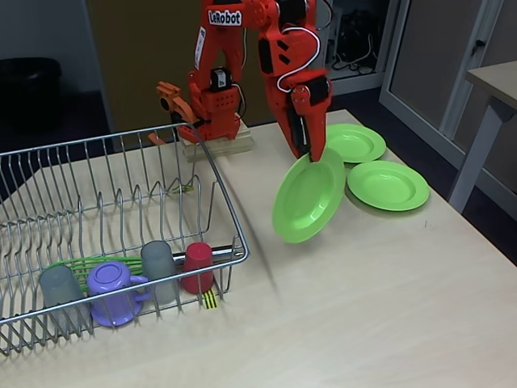
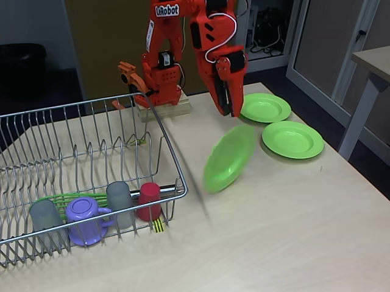
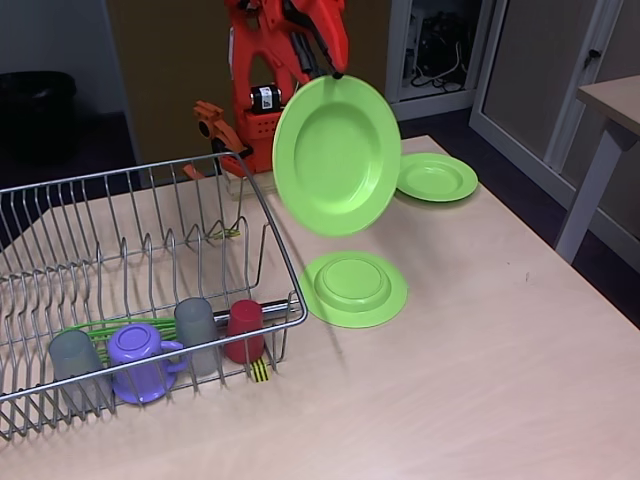
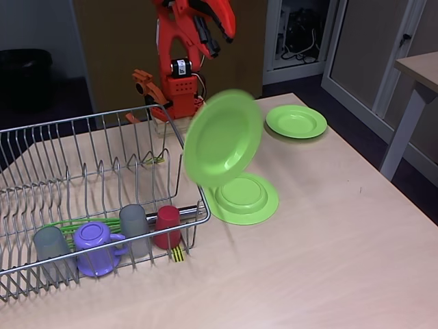

# Native-video event proposals: two-recording development pilot

**Experimental, operator-controlled.** Meta Muse Spark 1.3 received complete BotFails BF010 and BF000 videos through the native video API. This is distinct from the existing Fireworks Muse Spark Open evidence-reasoning workflow. The two requests were genuine; this report is a saved result, not a new execution. Provider-defined sampling does not establish that the model examined every frame.

## What was demonstrated

| Recording | Genuine model proposal | Independent source inspection | Machine-verified scope |
|---|---|---|---|
| BF010 | Drop, 39.5–45.5 s (frames 1185–1365) | A green plate visibly falls and lands on the table. Before/after separation is visible around frames 1327–1329 (44.233–44.300 s). | The drop remains **Unverified** by the deterministic verifier. |
| BF010 | Drop, 46.5–52.5 s (frames 1395–1575) | A second visible fall occurs around frames 1522–1524 (50.733–50.800 s). Settling continues beyond the proposed endpoint. | The drop remains **Unverified** by the deterministic verifier. |
| BF000 | Transfers into the rack; no drop proposal | Whole-recording contact-sheet inspection found no comparable visible fall. | No verified Success or full-task-completion conclusion. |

These visual checks were performed by an **AI reviewer**, not independent human ground truth. The short visual brackets above are post-response review observations, not model-predicted onset times or mechanical-release measurements. The coarse proposals include approach and manipulation. Earlier failure onset and physical cause remain unknown. Some model prose is inaccurate: for example, BF000 cup-orientation descriptions should not be treated as measurements.

The existing assisted final-placement detector still establishes only its narrow plate/rack image-space relationship at the end of BF010. It does not independently validate either temporal drop. This pilot adds useful automatically proposed earlier event intervals; it does **not** establish generalized failure-detection accuracy, verified grasp/release, or a causal diagnosis. The recordings are development examples, not a new held-out accuracy benchmark. No additional model runs on the other evaluation recordings were authorized.

## Inspect original evidence

Before and during the first visible fall:

Before and during the second visible fall:

The [BF010 output extract](../evaluation/native-video/BF010-model-proposals.json) and [BF000 output extract](../evaluation/native-video/BF000-model-proposals.json) preserve model-generated event text as **unverified proposals**. They include original recording/response hashes and exported-frame provenance. These documentation extracts are not inputs to the detector, signed runtime jobs, or replacements for the retained raw provider records. No private job directories, account data, API keys or full recordings are bundled here. See [asset notice](../evaluation/native-video/NOTICE.md).

## Execution and integrity

Both requests used the neutral task “Place all dishes in the rack” and desired condition “All required dishes are in the rack.” No publisher outcome, known event interval, earlier diagnosis, rack template or SAM mask was included in either model request. The verifier uses pre-existing source-backed placement evidence **after** model execution.

The retained records show two uploads and two completed Muse requests, with no retries. Independent review recomputed all **4,180 original RGB-frame hashes and native timestamps**, checked **42 proposal endpoint bindings**, and checked saved-job integrity and raw-response retention. The application distinguishes genuine saved proposals from offline mocks; model descriptions and causes remain unverified. Source-frame buttons seek the original recording. Reopening and refreshing use saved results without inference.

Rate-derived usage is **$0.03249475 + $0.03536350 = $0.06785825**. The earlier $0.0678525 summary was a transcription/calculation error. Ledger rounding and a provider invoice are separate: **the invoice has not been verified**. This historical low cost is not a future spending cap.

## Local use and boundaries

1. Follow the normal [README installation](../../README.md#quick-start). Six replay investigations need no credentials.
2. For the optional native-video pilot, first [provision the pinned original BF010/BF000 recordings](PORTABLE_PLACEMENT_SETUP.md). The bundled lossy re-encode is not a measurement-source substitute.
3. In **Import footage**, run the existing assisted final-placement assessment and open its saved investigation. In Findings, the native-video section can prepare an exact source/task/request plan without provider calls.
4. Paid execution is disabled unless a local operator supplies a separate, unexpired, exact-plan/implementation-bound authorization file via `DEMODOCTOR_NATIVE_VIDEO_APPROVAL`, authenticates their own Meta account, and approves the displayed **$1.33 per-plan reservation**. The ledger must admit the reservation. Ordinary offline startup does not supply this authorization. Browser confirmation alone cannot enable billing.
5. This bounded pilot supports only the stated dish-to-rack task and validated source-backed parent investigations. It is not a new general-purpose upload detector. Authorization, credentials and the ledger belong in ignored local storage, never Git or the browser. No ready-to-spend approval file is distributed.
6. One approved execution permits one upload and one Muse request, zero automatic retries, and no SAM/fallback/refinement calls. Failed or uncertain execution requires manual reconciliation. Do not rerun a completed plan.

The CLI interface is `python -m placement_assessment.video_integration --help`. The offline SDK mock runner is `scripts/native_video_offline.py`; its output is explicitly MOCK, not genuine inference. Original genuine runtime jobs remain private local artifacts; the public documentation extracts can be inspected without credentials. [Meta terms](https://dev.meta.ai/legal/terms-of-service) and account eligibility apply to future model use.

## Selective release verification, November 4

The staging integration starts from the accepted public final-placement release `f030846ed3eddc82b66bd03e5ac18e8016af5b9c`. Only the native-video adapter/verifier/UI, their tests and documentation were selected from worker `59f03e8d2195fe221ba7e1693b3e07f63549ca9d`; the rejected task-region experiments were not imported. No dependency lockfiles, original replay data, provider records, videos, licenses or build-history disclosures changed.

Executed checks: **54 focused Python tests**, **272 React tests**, production build, both full-source offline mock workflows, **15 genuine-result Chromium checks**, **11 mock-result Chromium checks**, and **19 existing placement/control/replay Chromium checks** passed. BF010 was recomputed from provisioned originals and retained frames 2074–2089 / 69.133333–69.633333 s; BF000 made no failure claim. An additional clean staged-file export passed `npm ci --offline --no-audit --no-fund`, build, backend startup without credentials and actual Chromium decoding/seeking for all six replays. Python reused the previously validated environment; `pip check` passed. A fresh Python dependency reinstall and the entire research test suite were not repeated because dependencies and frozen research files were unchanged. These engineering checks are not accuracy statistics.
